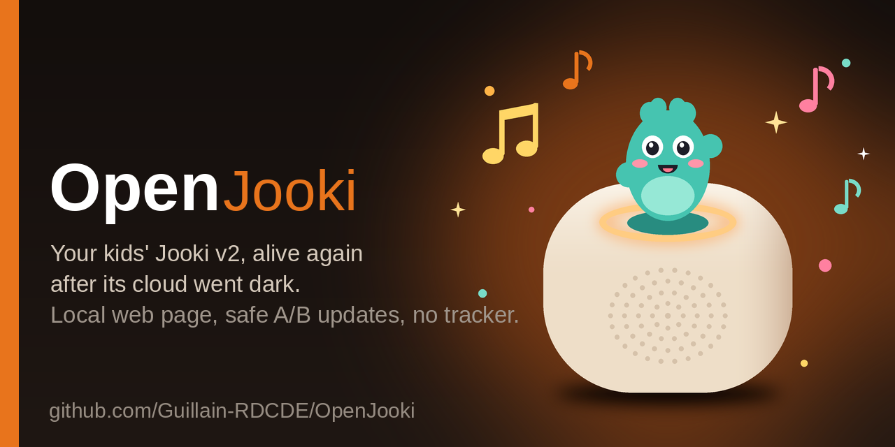
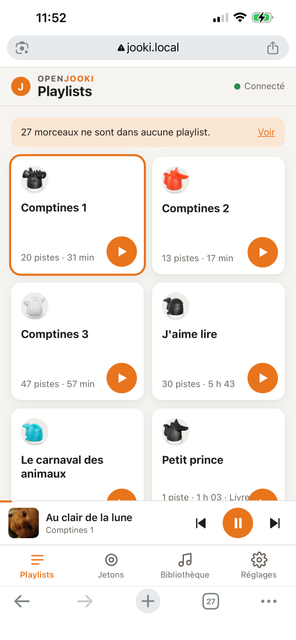
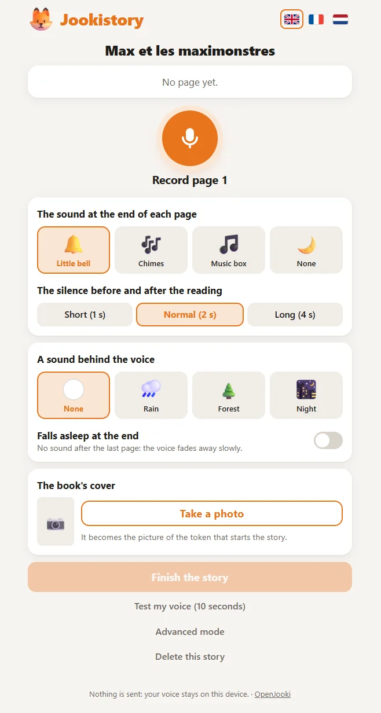
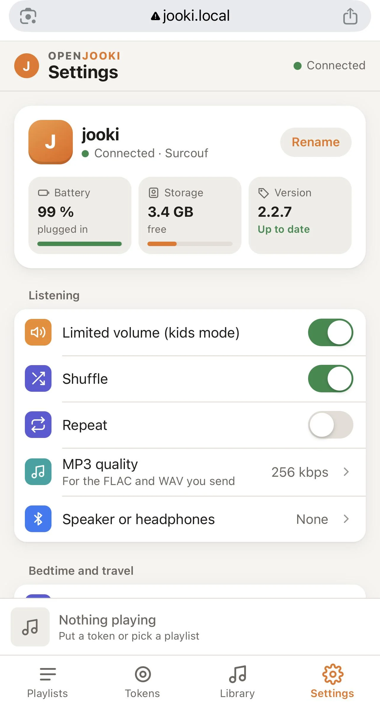

# OpenJooki

<!-- opening -->
> A children’s music speaker whose maker went out of business. This keeps it working, from a phone, for parents who are not technicians.
>
> A replacement core on the device’s embedded Linux, over-the-air updates, Bluetooth, Spotify, a story studio, and a fresh SD-card image for a unit that no longer starts.
>
> Abandoned hardware rescued end to end, and documented for people who will never read code. Part of the work of [Guillain d’Erceville](https://github.com/Guillain-RDCDE), forward deployed engineer.
<!-- opening -->

**Your child's Jooki 2 keeps working, and gets better, even though the Jooki company is gone.**
Free, made by a parent, not affiliated with Muuselabs / Jooki.

  
  &nbsp;
  
  &nbsp;
  

The Jooki's page on a phone · Jookistory, a story read by you · Settings

## What do you need?

| Your situation | Go here |
|---|---|
| My Jooki works, but the app doesn't any more | **[Install OpenJooki](guide/install.md)** · 15 min, from your phone |
| I have OpenJooki: playlists, tokens, bedtime, Bluetooth speaker… | **[Use it](guide/use.md)** |
| I want to read a story myself | **[Jookistory: a story read by you](guide/use.md#a-story-read-by-you)** |
| Grandma reads from far away, and the book gets its own token | **[From far away](guide/use.md#a-story-read-from-far-away)** · **[Labels for the books](guide/use.md#labels-for-the-books)** |
| I use Spotify on my phone | **[Spotify on the Jooki](guide/use.md#spotify)** |
| A new version is out | **[Update it](guide/update.md)** · from the Jooki's page |
| My Jooki doesn't start any more | **[A new SD card](https://guillain-rdcde.github.io/OpenJooki/sdcard.html#new)** · 10 min with a computer |
| No more room for music | **[A bigger SD card](https://guillain-rdcde.github.io/OpenJooki/sdcard.html#bigger)** · with a computer |
| It lost its Wi-Fi (moved house, new box, new password) | **[Give it its Wi-Fi back](https://guillain-rdcde.github.io/OpenJooki/wifi.html)** · Android phone or computer |
| I want the original Jooki back | **[The original Jooki card](https://guillain-rdcde.github.io/OpenJooki/sdcard.html#original)** |
| We're going away: holiday, car, no Wi-Fi | **[Away from home](guide/travel.md)** |
| The lights, the battery, the charger | **[What they mean](guide/lights-and-battery.md)** |
| Anything else | **[Questions](guide/questions.md)** |

**New in 2.4.4:** Settings → Spotify shows the Jooki's own Spotify account and can change it, so a token no longer stops another Spotify speaker at home.
2.4.3: the Jooki finds its Wi-Fi by itself at every start again, and your Wi-Fi password no longer stays in its logs.
[All the changes](CHANGELOG.md)

---

**How it works** (for the curious and the technical): [docs/](docs/README.md) ·
Guillain d'Erceville, guillain@poulpe.us · MIT license. Built to be safe, but use it at
your own risk.
